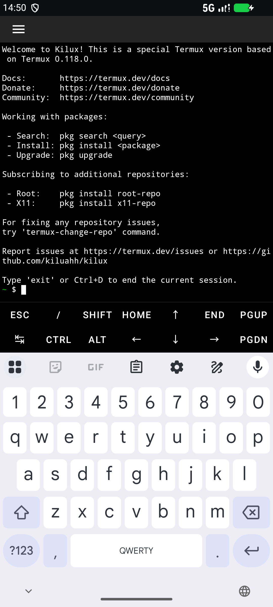
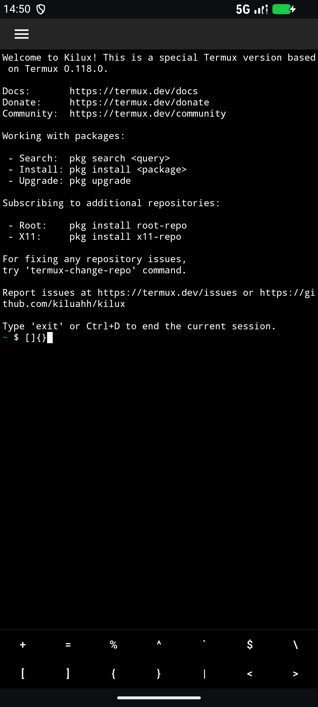
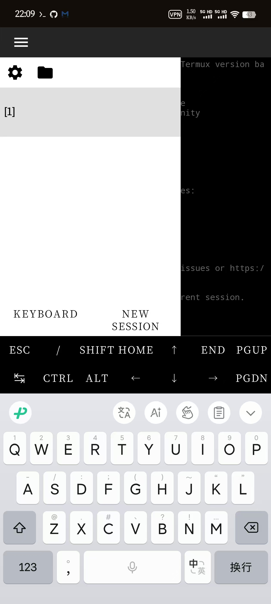
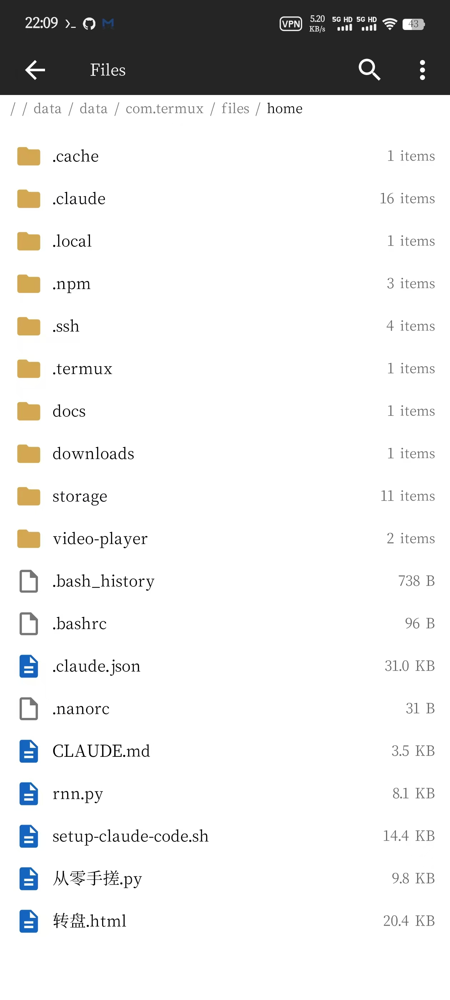

# Kilux

**Kilux** 是基于 [Termux](https://github.com/termux/termux-app) 0.118.0 的 Android 终端环境定制分支，合并了 `termux-api`，并内置文件管理器、带行号的文本编辑器与 Claude Code 一键安装脚本。包管理、`pkg` 源与插件生态与原版 Termux 完全一致，可以继续 `pkg install` 任意软件包。

> 分支：`kilux-termux`　主工程目录：`kilux-app-main/`（5 个 Gradle 模块）

## 下载

[](https://github.com/kiluahh/kilux/releases/latest)
[](https://github.com/kiluahh/kilux/releases)
[](kilux-app-main/LICENSE.md)

**安装包在 [Releases](https://github.com/kiluahh/kilux/releases/latest)**，下载 `termux-app_apt-android-7-release_universal.apk` 直接安装即可（通用包，含 arm64-v8a / armeabi-v7a / x86 / x86_64 四种架构，无需 root）。

- 包名 `com.termux`，应用名 **Kilux**，最低 Android 5.0（API 21）
- 与原版 Termux / F-Droid 版包名相同但**签名不同**，两者不能共存，也无法覆盖安装；需要保留原版数据请先备份
- 首次启动会联网解压 bootstrap，装好即可 `pkg install` 任意软件包
- 同一签名的新版本可直接覆盖升级

## 截图

| 主界面 | 常用符号页 |
| --- | --- |
|  |  |

| 抽屉侧边栏 | 文件管理器 |
| --- | --- |
|  |  |

## 主要特性

- **三页终端工具栏**：额外按键页 → 常用符号页（`+ = % ^ \` $ \ [ ] { } | < >` 共 14 个符号键）→ 单行文本输入页。工具栏高度按两页中最大行数计算，翻页时不会跳动。
- **抽屉侧边栏**：会话列表，以及设置、文件管理器快捷入口。
- **文件管理器**：目录浏览、多选、复制、移动、删除、重命名、用 Termux 打开文件。
- **文本编辑器**：带行号栏的编辑界面，支持打开与保存。
- **完整 termux-api**：约 55 个 API 脚本 + 8 个原生二进制（4 架构 × 2 程序），摄像头、剪贴板、通知、传感器等接口开箱可用。
- **Claude Code 一键安装**：安装脚本不依赖 RPATH，优先使用 bionic 库路径，无 root 也可运行。
- **细节打磨**：自定义欢迎语（`$PREFIX/etc/motd`）、底部工具栏分隔线、默认 `SHIFT` 键替换 `-`、安装时自动过滤 Windows `core.autocrlf` 产生的 CRLF 脚本。
- **日期版本号**：`YYYY.MM.DD.N`，每个版本都有独立的 `changelogs/` 记录。

## 仓库结构

| 路径 | 说明 |
| --- | --- |
| `kilux-app-main/` | Android 主工程：`app`、`termux-shared`、`terminal-emulator`、`terminal-view`、`termux-api` 五个模块 |
| `changelogs/` | 每个版本的更新记录（`YYYY.MM.DD.N.md`） |
| `preview/` | README 使用的界面截图 |
| `version.sh` | 计算日期版本号并写入 `app/build.gradle` |
| `CLAUDE.md` | 项目结构、构建命令与改造点说明 |

## 构建

前置条件：JDK 17、Android SDK（compileSdk 36）、NDK 29.0.14206865，`minSdk 21` / `targetSdk 28`。

```bash
# 1. 更新版本号（日期 + 序号，生成 changelog）
./version.sh -m "本次改动摘要"

# 2. 构建 Debug APK
cd kilux-app-main
JAVA_HOME="/path/to/jdk" \
ANDROID_HOME="/path/to/android-sdk" \
ANDROID_NDK_HOME="/path/to/android-sdk/ndk/29.0.14206865" \
./gradlew assembleDebug
# 产物：app/build/outputs/apk/debug/termux-app_apt-android-7-debug_*.apk
```

Release 构建需要 `app/release-key.jks` 签名文件：`./gradlew assembleRelease`。

## 版本

当前版本 **2026.11.07.1**（versionCode `202611071`）。版本号由 `version.sh` 统一维护，`app/build.gradle` 中的 `validateVersionName()` 会校验日期格式。

## 许可证

本项目基于 Termux，遵循 [GPLv3](https://www.gnu.org/licenses/gpl-3.0.html)，详见 [`kilux-app-main/LICENSE.md`](kilux-app-main/LICENSE.md)。
